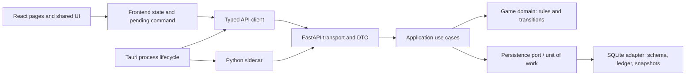

# План и ход внедрения архитектуры NOIR Casino Club

Срез: 2026-09-28, ветка `feature/blackjack-release`, текущее рабочее дерево. Документ объединяет целевую архитектуру, этапы внедрения и подтверждённый статус раздела 8. Часть архитектурного переноса уже выполнена; оставшиеся выпускные проверки не считать пройденными по факту наличия кода. Незакоммиченные правки backend и frontend сохранять и перед каждым этапом повторно сверять с кодом.

## 1. Цель и границы

Цель — сделать путь игрового действия от WebView до SQLite понятным, проверяемым и безопасным для изменения правил, сохранений и UI. Целевой вариант — **локальный модульный монолит**: React + TypeScript показывает состояние, Tauri запускает локальный sidecar, FastAPI принимает команды, Python выполняет правила, SQLite атомарно хранит профиль и журнал фишек. Публичные URL и формат успешных ответов сохраняются во время структурного переноса.

Предположения, которые нужно подтвердить при планировании релиза: продукт остаётся Windows desktop для одного локального профиля; фишки виртуальные; онлайн-синхронизация, платежи и несколько независимых пользователей не нужны; работа ведётся небольшой командой. Если эти условия изменятся, пересмотреть архитектуру до реализации соответствующей функции. Лимиты объёма истории и допустимая задержка действия пока не заданы; сначала измерить их, затем задавать численные бюджеты.

Этот план дополняет [backend-refactor-roadmap.md](backend-refactor-roadmap.md) и [casino-next-development-roadmap.md](casino-next-development-roadmap.md). Их пункты про миграцию, ledger, retry и выпуск ранней альфы остаются обязательными воротами. Статусы в старых документах нельзя считать состоянием сегодняшнего дерева без повторной проверки: например, `recovery.py` уже использует `BackendProcessLock`, хотя N2 описывает отсутствие такой защиты.

## 2. Текущее состояние и архитектурные риски

| Область | Наблюдаемое состояние | Риск/цель |
|---|---|---|
| Backend | HTTP/DTO находятся в `api.py` и `api_schemas.py`; application use cases и сервис — в `application/`; правила — в `domain/`; SQLite, migrations и codecs — в `persistence/`. Старые root modules остаются фасадами. | Проверять инварианты на границе service/repository и сохранять совместимость импортов, пока текущие callers не переведены. |
| Игровое состояние | `CasinoService` держит in-memory снимок, обновляет его по revision и выполняет команды через `CasinoRepository` + разделённые read/write Unit of Work protocols; SQLite connection остаётся внутри adapter. Транзакции охватывают профиль, blackjack, историю, ledger, seed и idempotency response. | Продолжать проверку кэша после ошибки/commit, активной blackjack-руки при старте и любого денежного writer. |
| HTTP и frontend | FastAPI создаётся через `create_app`; машинные коды ошибок выделены. Frontend разделён на `apiConfig.ts`, `httpClient.ts`, `casino.api.ts`, `casino.commands.ts` и `platform/desktopBackend.ts`. DTO на TS стороне остаются ручными. | Vite и packaged WebView проверили pending POST, retry после HTTP 502 и reload; остаётся contract gate против расхождения DTO. |
| Desktop | Tauri запускает Python sidecar с токеном и nonce; close coordinator отменяет закрытие, выполняет единственный shutdown и уничтожает окно после остановки backend; startup гонка также отменяется. Установленный NSIS из snapshot `d11c0af` прошёл gameplay/retry/backup/restore/relaunch и close-request event bridge smoke. Текущий packaged executable прошёл native Windows `WM_CLOSE`: приложение и sidecar завершились, изолированный save прошёл recovery verify. | Close coordinator покрыт unit-тестами; физический клик по native titlebar и полный smoke log остаются для ручной проверки на целевой машине. |
| Сохранения | SQLite schema v4, typed ledger, backup/verify/restore, JSON codecs и импорт legacy вынесены в `persistence/`; recovery защищён process lock. | Любое изменение формата требует проверки миграций v0–v4 и восстановления на копии пользовательской базы. |

## 3. Целевые границы



Направление зависимостей: transport и adapters зависят от application/domain; domain не импортирует FastAPI, SQLite, React и Tauri. Application открывает **один** unit of work на команду: чтение актуального снимка и idempotency key → проверка → переход игры → movements → запись профиля, истории, ledger, ответа и seed → commit. Один публичный read use case получает согласованный снимок. `Blackjack` остаётся отдельным stateful aggregate; рулетка и слоты остаются one-shot играми. Не вводить общий интерфейс с пустыми `start/action` для всех игр.

Текущая структура после переноса:

```text
backend/casino/
  api.py, api_schemas.py, api_errors.py
  application/{commands,queries,service,ports,errors}.py
  domain/{models,blackjack,games,rules,ledger,round_verifier,errors}.py
  persistence/{sqlite,migrations,codecs}.py
  recovery.py, process_lock.py
backend/run_api.py
frontend/src/
  App.tsx, hooks/useCasino.ts
  features/{blackjack,roulette,slots,history}/
  lib/{apiConfig,httpClient,casino.api,casino.commands}.ts
  platform/desktopBackend.ts
frontend/src-tauri/
```

Эта структура в основном уже внедрена. Следующие изменения должны закрывать оставшиеся проверки и только затем удалять compatibility facades. Не создавать абстракции для единственного SQLite adapter без конкретной потребности тестирования или замены IO.

## 4. Ключевые решения и альтернативы

| Решение | Почему сейчас | Цена и условие пересмотра |
|---|---|---|
| Один локальный sidecar и SQLite, модульный монолит | Соответствует desktop-продукту и существующему коду; транзакции и восстановление остаются локальными. | При облачном профиле или совместной игре нужен новый анализ синхронизации, авторизации и конфликтов. Не добавлять микросервисы заранее. |
| Application service владеет транзакцией и idempotency | Только здесь можно атомарно связать результат, wallet, историю, seed и сохранённый ответ. | Use case становится координатором; правила ставок/выплат держать в domain, SQL в adapter. |
| Ledger и профиль сохраняются вместе | Профиль даёт быстрый read, ledger позволяет доказать изменение баланса. | Дублирование данных требует reconciliation при загрузке и на записи; старые неоднозначные записи не исправлять молча. |
| Ручные TS DTO на первом шаге, контрактная проверка против OpenAPI | Меньше одновременных изменений, текущие API уже используются UI. | При повторном расхождении или расширении API перейти на генерацию типов, не создавать второй независимый набор схем. |
| Версионированные правила и codec сохранения | Исторические результаты и активная рука переживают смену реализации. | Увеличение формата; старые записи показывать как legacy, не пересчитывать их по новым правилам. |

Шесть ADR для этих решений находятся в `docs/architecture/ADR-001`–`ADR-006`; они фиксируют контекст, альтернативы, цену решений и условия пересмотра.

## 5. Порядок внедрения

Каждый этап заканчивается отдельным проверяемым результатом. Зависимости задают порядок; внутренние переезды модулей не должны опережать защиту данных и контрактов.

| Этап | Работа и затронутые места | Готово, когда |
|---|---|---|
| A. Зафиксировать baseline | Сверить diff и текущие статусы N0–N8; записать контекст/ADR; сохранить fixtures SQLite v0–v3, JSON, blackjack snapshots и HTTP ответов. Рабочие файлы: `backend/tests/fixtures`, `backend/tests`, `frontend/tests`, `docs/architecture`. | Команды backend/frontend воспроизводимы; список фактически открытых пунктов и известных версий сохранений записан; пользовательские базы не попали в Git. |
| B. Защитить данные и выпускной путь | Закрыть подтверждённо открытые N1–N3: preflight/backup перед миграцией, проверка restore при живом backend, запрет обходного денежного writer. Файлы: `storage.py`, `recovery.py`, `process_lock.py`, тесты. | Миграция на копиях всех fixtures не теряет баланс/руку/ledger; fault injection оставляет исходник или проверенную копию; writer не меняет баланс без типизированного movement. |
| C. Выделить доменные переходы | Закрепить правила v1 и `rule_version`; закончить N4/N6; выносить сериализацию/миграции из `storage.py`, а применение effect из `session.py` в небольшие use cases без смены HTTP. Файлы: `blackjack.py`, `games.py`, `rules.py`, `models.py`, `session.py`, codecs. | Domain tests работают без FastAPI/SQLite; каждый переход даёт проверяемые effects; старые fixtures читаются; golden traces, ledger и HTTP snapshots не изменились без отдельного решения. |
| D. Укрепить границу API/client | Закончить N5; добавить стабильные machine-readable `code` к ошибкам, сохранив `detail`; договориться об одном источнике DTO; разделить startup sidecar, HTTP и pending-command в `casino.api.ts` и `useCasino.ts` небольшими шагами. | Lost-response → restart → retry сохраняет один settlement; 400/401/409/422 различаются; клиент показывает подтверждённое состояние после конфликта; TS build и contract tests зелёные. |
| E. Стабилизировать desktop composition | Проверить N7: единый способ запуска/остановки sidecar, токен/nonce, loopback и CSP; собрать чистый Windows installer; проверить закрытие окна и повторный запуск. Файлы: `frontend/src-tauri`, `frontend/src/platform`, build scripts. | Установленное приложение играет, сохраняет активную руку, переживает restart и неизвестный исход POST; после закрытия нет лишнего backend; инструкции сборки воспроизводимы. |
| F. Финальные ворота | Выполнить N8, независимую проверку баланса/ledger, импорт и recovery на доступной **копии** пользовательской базы, полный набор тестов и UI smoke. Обновить README и ADR по факту. | Нет открытого P0/P1 дефекта сохранений, выплат или retry; известные legacy-ограничения записаны; решение о ранней альфе основано на результате installer и restore smoke. |

Для этапов C–E применять «ветвь за ветвью»: сначала тестируемая граница, затем один use case или одна функция клиента, затем удалить старый путь. Не делать параллельный второй writer, который может расходиться с ledger. Внешний `CasinoSession` может временно оставаться фасадом для текущих тестов и API.

## 6. Обязательные архитектурные инварианты

1. `balance >= 0`, а новый баланс равен старому плюс сумма movements; ledger chain и профиль сходятся после каждого commit.
2. Повтор `key + payload` возвращает сохранённый ответ без нового эффекта; тот же key с другим payload даёт конфликт. До выяснения исхода POST UI не отправляет другую команду.
3. Профиль, активная рука/башмак, история, ledger, seed и cached response фиксируются или откатываются вместе.
4. Правила выплат v1 не меняются при переносе модулей; изменение правил требует новой версии и отдельного продуктового решения.
5. Мигратор сначала проверяет и копирует источник. Невалидная или неизвестная версия останавливает запуск с диагностикой, не сбрасывая профиль.
6. Domain можно запустить с фиксированным RNG без сети и БД. HTTP и WebView не рассчитывают исходы или баланс сами.

Проверять эти инварианты на unit уровне для игр, SQLite integration для транзакций/миграций, HTTP contract для DTO/retry и установленном Tauri приложении для lifecycle. Не добавлять искусственные тесты только ради покрытия перенесённого кода.

## 7. Риски и условия остановки

- **Старые сохранения.** Неизвестный порядок сброшенных карт и происхождение некоторых старых ledger записей нельзя восстановить вычислением. Отмечать такие данные как legacy/ambiguous, сохранять копию и не обещать историческую доказуемость.
- **Большой структурный PR.** Одновременное переименование Python и TS затруднит обнаружение регрессии. Ограничивать этап изменением одной границы с проверкой публичного контракта.
- **Порт и процесс sidecar.** Изменение loopback адреса/порта потребует согласованной правки API client, Tauri CSP и smoke. До успешного installer теста считать выпускной риск открытым.
- **Производительность.** `storage.py` сверяет ledger; менять формат истории или оптимизировать запросы только после замера на реалистичном объёме сохранения.

Остановить соответствующий этап для отдельного ADR и продуктового решения, если появляются онлайн-профиль, реальные деньги, новые правила игры, breaking API или формат сохранения, который нельзя прочитать старым клиентом.

## 8. Текущий ход внедрения

- **Сделано в рабочем дереве:** игровые правила и модели перенесены в `backend/casino/domain/`; команды находятся в `application/commands.py`, read projection — в `application/queries.py`, а `CasinoService` собирает application flow через `CasinoRepository`, read-only `CasinoReadUnitOfWork` и расширенный write `CasinoUnitOfWork`. SQLite connection закрыт внутри adapter; decision зафиксирован в ADR-006. SQLite adapter находится в `backend/casino/persistence/sqlite.py`; схема v4 и JSON codec — в `persistence/migrations.py` и `persistence/codecs.py`. Типизированные ledger movements связывают domain transitions с persistence. Restore копирует и проверяет источник и backup назначения, checkpoint'ит старый WAL и переключает назначение в DELETE journal перед заменой. Pending POST теперь уходит только после сохранения ключа повтора; повреждённый pending state блокирует новые команды, а не теряется молча; после загрузки UI показывает ожидающую команду. Обработка конфликтов и повторов в casino hook централизована; retry после перезапуска сохраняет сообщение об ошибке после синхронизации state. HTTP собирается через `create_app()` с возможностью внедрить `CasinoService`; default service создаётся лениво при запросе, после того как `run_api.py` получает process lock. В 400 переводятся только явные `InvalidCasinoCommand`, а неожиданные `ValueError` не маскируются как клиентский ввод. Шесть решений зафиксированы в `docs/architecture/ADR-001`–`ADR-006`. Ошибки имеют единый формат с сохранённым `detail` и машинным `code`. Desktop lifecycle в `desktopBackend.ts` проверяет token/nonce и отменяет гонку старта; `desktopLifecycle.mjs` делает shutdown единственным и дожидается его перед уничтожением окна. Установленный close-request event bridge smoke остановил sidecar; 3 unit-теста проверяют close sequence. Физический native titlebar input остаётся ручным выпускным gate. README описывает новые source boundaries и desktop build flow. HTTP transport находится в `frontend/src/lib/httpClient.ts`, pending mutation и retry — в `frontend/src/lib/casino.commands.ts`.
- **Переходный слой:** основные backend tests теперь импортируют `casino.application`, `casino.domain` и `casino.persistence`; отдельный `test_compatibility_facades.py` проверяет старые `casino.blackjack`/`games`/`models`/`session`/`storage` и соседние exports. Domain/application exceptions живут в своих пакетах, а `casino.errors` только переэкспортирует их для старых callers. Fitness tests не допускают обратной зависимости canonical packages от этого root facade. Другие compatibility фасады остаются для внешних callers до проверки срока удаления.
- **Проверено:** 92 backend tests проходят на Python 3.10 и 3.12, включая два property-based blackjack state machines, import-boundary и compatibility facade tests; frontend unit tests — 9/9; Ruff check/format, mypy (36 файлов), frontend production build и lint проходят. `cargo check` прошёл на rustup MSVC Rust 1.97.1. MSI/NSIS из чистого snapshot `8c4ec99` сохранены в отдельном `%TEMP%` target; более поздний installed NSIS gameplay/recovery и close-request event bridge smoke из `d11c0af` отмечены в `casino-next-development-roadmap.md`. Vite browser UI воспроизвёл committed blackjack action → HTTP 502 → reload → retry: pending banner пережил reload, cached outcome не добавил ledger movement; отдельная SQLite дала `quick_check=ok`, balance 2480, 4 processed requests, 2 stake movements, 2 payout movements и 2 раунда. Свежий no-console PyInstaller sidecar с piped stdio прошёл backup активной руки → shutdown → restore → restart → settlement → recovery verify; после restore balance был 2490. Текущий packaged executable прошёл native `WM_CLOSE`: окно и sidecar завершились, save прошёл recovery verify. Физический клик по titlebar остаётся ручной проверкой перед распространением.
- **Дальше:** перед распространением вручную нажать native titlebar на целевой машине; локальные close lifecycle, backup/recovery, installer gameplay, retry и migration уже проверены. Не удалять compatibility exports до проверки внешних callers.
