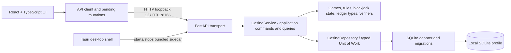

# Контекст проекта для AI-агента

## Что это за проект

NOIR Casino Club — локальное Windows desktop-приложение на Tauri с React/TypeScript UI и Python/FastAPI sidecar. Игрок перемещается между лобби, blackjack, slots, roulette и историей. Приложение хранит один локальный профиль и использует только виртуальные demo-фишки: платежей, депозитов, вывода средств, реальных денежных ставок и multiplayer нет.

Backend является источником истины для баланса, лимитов, правил и результата игр, статистики, истории и активного blackjack. Frontend показывает это состояние и отправляет команды. Установка и desktop-разработка ориентированы на Windows; Vite также позволяет запускать UI в браузере вместе с отдельно запущенным API.

## Продуктовые ограничения

- Название: NOIR Casino Club. Пять существующих комнат: lobby, blackjack, slots, roulette, history.
- Ставки выражены целыми виртуальными фишками. Не называйте их деньгами и не вводите внешние финансовые интеграции.
- Не придумывайте метрики, игроков онлайн, результаты, рекомендации или account state: показывайте только данные backend.
- Поддерживайте клавиатурную навигацию, видимый focus, читаемый контраст, `prefers-reduced-motion` и минимум окна 920×640. Default window задан как 1280×860.
- Для визуальных решений сверяйтесь с [PRODUCT.md](../../PRODUCT.md) и [DESIGN.md](../../DESIGN.md); не меняйте существующий стиль и навигацию без продуктовой причины.

## Архитектура в одном взгляде



### Backend

- `backend/run_api.py` — executable entry point. Держит межпроцессную блокировку сохранения и запускает uvicorn только на `127.0.0.1`, default port `8765` (`NOIR_CASINO_API_PORT` можно переопределить).
- `backend/casino/api.py` — FastAPI composition root, HTTP routes, validation/auth/error translation. `create_app()` принимает application service для изолированного запуска.
- `backend/casino/api_schemas.py`, `api_errors.py` — входные/выходные DTO и HTTP ошибки. Request DTO запрещают неизвестные поля.
- `backend/casino/application/service.py` — загрузка текущего снимка, stale revision refresh и тонкие методы для command handlers.
- `backend/casino/application/commands.py` — изменяющие состояние игровые/wallet use cases; держат всю команду в одной write transaction.
- `backend/casino/application/queries.py` — проекция состояния для API.
- `backend/casino/application/ports.py` — `CasinoRepository`, read UoW и write UoW protocols. Application не получает SQLite connection.
- `backend/casino/domain/` — игровые модели и переходы состояний (`blackjack.py`, `games.py`), игровые интерфейсы (`core.py`), profile/result модели (`models.py`), движения ledger (`ledger.py`), версии правил (`rule_metadata.py`), проверка истории (`round_verifier.py`) и slot fairness (`slot_fairness.py`).
- `backend/casino/persistence/sqlite.py` — `PlayerRepository`, connection, SQLite транзакции, profile/ledger/idempotency operations и legacy import.
- `backend/casino/persistence/migrations.py` — версии схемы SQLite (сейчас schema version 4); `codecs.py` — сериализация и совместимость сохранённых snapshots.
- `backend/casino/recovery.py` и `process_lock.py` — offline backup/verify/restore и блокировка процесса.
- `backend/casino/session_report.py` — сохраняет отчёт локальной desktop-сессии при штатном shutdown sidecar.
- Root модули вроде `casino.session`, `casino.storage`, `casino.blackjack`, `casino.games`, `casino.models` и другие оставлены как compatibility facades. Перед удалением или переносом символа проверьте imports и `test_compatibility_facades.py`.

### Frontend и desktop

- `frontend/src/App.tsx` задаёт оболочку и страницы/комнаты. `components/` содержит shell, lobby и общие компоненты; `features/` — отдельные игровые страницы, shared game UI и history.
- `hooks/useCasino.ts` связывает API state, loading/error/notice feedback и действия интерфейса.
- `lib/httpClient.ts` отвечает за HTTP transport; `lib/apiConfig.ts` — base URL; `lib/casino.api.ts` — типизированные операции API; `lib/casino.commands.ts` и `pendingMutations.mjs` — сохранение pending mutation и повтор того же запроса.
- `types.ts` — вручную синхронизируемые frontend DTO. Проверяйте их вместе с Pydantic DTO и fixtures, когда меняете контракт.
- `platform/desktopBackend.ts` запускает и останавливает production sidecar, добавляет token header и проверяет instance nonce. В dev API запускается отдельно.
- `frontend/src-tauri/` содержит Rust shell, Tauri permissions/capabilities, window/CSP/bundle config и sidecar registration. `frontend/scripts/tauri.mjs` на Windows подбирает rustup MSVC toolchain и Visual Studio environment.
- `frontend/src/features/slots/slotFairness.mjs` — frontend verifier slot proof, а не генератор исходов.
- `frontend/src/features/slots/SlotSymbol.tsx` рисует игровой символ 🍋 как лимон на барабанах и в таблице выплат.

## Критические runtime-инварианты

### Изменение баланса и повтор запроса

Изменяющий API POST обязан содержать уникальный `idempotency_key` (1–128 символов). Под одной транзакцией сервис читает свежий профиль и сохранённый ответ, проверяет ключ/подпись запроса, правила и баланс, выполняет переход домена и сохраняет профиль, активное состояние, историю, ledger movements и полный response. Повтор идентичного запроса возвращает сохранённый ответ без повторного перехода; после успешной мутации frontend перечитывает `/api/state`, чтобы отобразить актуальный профиль и игру. Тот же key с другими параметрами — конфликт без второго списания.

После сетевой ошибки клиент не знает, успел ли сервер commit. Pending mutation поэтому сохраняет исходное тело и ключ и повторяет те же данные. Не заменяйте неизвестный запрос новым ключом: это может провести ту же ставку второй раз.

### Ledger и persistence

- `profile.balance` — материализованный баланс; typed append-only ledger объясняет каждое изменение. Их обновление атомарно.
- При чтении проверяются последовательность `balance_after` и соответствие итогового баланса profile. Несовпадение требует диагностики; не «чините» баланс автоматически.
- SQLite сериализует записи через транзакцию `BEGIN IMMEDIATE`; revision позволяет нескольким backend service instances обновлять свой in-memory snapshot.
- Стандартный файл — `~/.noir-casino/casino.sqlite3`. Если он впервые создан и рядом есть `player.json`, старый JSON импортируется; исходник сохраняется. `NOIR_CASINO_SAVE_PATH` задаёт другой путь, а путь с `.json` выбирает соседний `.sqlite3` и JSON-источник миграции.
- Перед восстановлением backend должен быть остановлен; restore CLI блокирует активный backend. Для существующего target нужен `--replace`, и текущая база сначала сохраняется.
- Schema version и формат blackjack snapshot — разные версии. Миграции SQL не оправдывают изменение или пересчёт старой выплаты.

### Игры и доказательства

- Rules/configuration находятся в домене: `BlackjackRules`, `RouletteRules`, `SlotRules`, общие `GameRules`. HTTP handlers и UI не должны становиться вторым местом реализации правил.
- One-shot slots и roulette используют общий `CasinoGame` contract. Blackjack — отдельный stateful aggregate; текущий ход и допустимые действия должны приходить из backend.
- Slots, roulette и blackjack используют общий commit/reveal поток: `/api/state` публикует SHA-256 commitment, команда принимает client seed и ожидаемый hash, а завершённый результат раскрывает proof. Seed хранится в SQLite; active blackjack snapshot сохраняет proof и порядок добора. UI проверяет commitment и воспроизводит игровые данные; это не аудит независимого генератора или защита от владельца машины. Смотрите [профильную страницу](provably-fair.md).
- Для новых раундов сохраняются version/fingerprint/snapshot/outcome там, где это применимо. История без достаточных данных остаётся legacy/unverified; не проверяйте её новыми правилами задним числом.
- Правки выплат или существенных правил требуют явного решения о версии и согласованного изменения backend, verifiers, DTO, frontend и документации.

## HTTP-контракт и desktop lifecycle

| Метод и путь | Назначение |
|---|---|
| `GET /api/health` | Health check; sidecar может вернуть instance nonce |
| `GET /api/state` | Профиль, игры/лимиты, history и blackjack state |
| `POST /api/games/{game_id}/play` | Slots или roulette round |
| `POST /api/blackjack/start` | Начать blackjack |
| `POST /api/blackjack/action` | Выполнить допустимое blackjack действие |
| `POST /api/refill` | Начислить demo chips |
| `POST /api/shutdown` | Внутренний authenticated graceful shutdown sidecar |

Все игровые и wallet mutation POST требуют idempotency key; внутренний `/api/shutdown` аутентифицируется token-ом и не является игровой командой. API в обычном dev режиме может не требовать token; desktop sidecar запускается с `NOIR_CASINO_API_TOKEN` и instance nonce. Frontend передаёт token в `X-Noir-Api-Token`, сверяет nonce, при закрытии просит graceful shutdown и затем завершает child при необходимости. У desktop dev/prod CSP есть явный loopback endpoint, поэтому изменение порта требует синхронной проверки frontend config и Tauri CSP.

Ожидаемые категории ошибок: 400 — некорректная игровая команда; 401 — неверный token; 409 — конфликт idempotency или устаревший commitment игры; 422 — невалидная форма запроса. Поле `server_seed_hash` публикует общий commitment; прежнее `slots_server_seed_hash` сохраняется как совместимый alias. Сверяйте точные `code/detail` с `api_errors.py` и контрактными тестами перед изменениями.

Frontend ограничивает HTTP запрос 15 секундами. При timeout или потере связи исход mutation считается неизвестным: сохранённая команда остаётся заблокированной для изменения и повторяется с теми же route, payload и idempotency key. При 409 клиент перечитывает `/api/state`, очищает конфликтующий запрос и показывает обновлённое состояние. Повреждённая или не входящая в allowlist запись блокирует новые mutations до восстановления корректного состояния.

## Разработка, сборка, проверка

Из корня, PowerShell:

```powershell
uv sync
cd frontend
npm install
npm run tauri:dev
```

Для браузерного UI откройте два терминала из корня проекта:

```powershell
uv run --directory backend python run_api.py
```

```powershell
cd frontend
npm run dev
```

Backend checks (из корня):

```powershell
uv run --directory backend --group test python -m unittest discover -s tests -q
uv run --directory backend --group quality ruff check casino tests run_api.py
uv run --directory backend --group quality ruff format --check casino tests run_api.py
uv run --directory backend --group quality mypy --python-version 3.10 casino
```

Frontend checks (из `frontend/`): `npm run test:unit`, `npm run lint`, `npm run build`. Полная desktop сборка: сначала `uv sync --group build` из корня, затем `npm run build:desktop` или `npm run tauri build` из `frontend/`. Desktop build требует rustup, MSVC C++ build tools и Windows SDK; packaging не заменяет ручную проверку установленного runtime и sidecar lifecycle.

После `npm run tauri build` команда `npm run smoke:sidecar` проверяет packaged sidecar на временной базе: token, state, один игровой запрос, graceful shutdown, восстановление баланса и истории после перезапуска, а также replay того же idempotency key после перезапуска. Она не запускает установленное GUI приложение.

Не запускайте проверку на пользовательском save без согласованной копии. Recovery verify — read-only по исходному файлу, но backup/restore и обычный backend могут создавать/менять данные в выбранном пути.

## Карта тестов

- `backend/tests/test_games.py`, `test_blackjack.py`, `test_blackjack_stateful.py`, `test_blackjack_properties.py` — правила и переходы состояний.
- `backend/tests/test_save_fixtures.py`, `test_recovery.py` — старые SQL/JSON snapshots, миграции, повреждённые данные и recovery.
- `backend/tests/test_api_auth.py` — HTTP routes/auth/validation/ошибки и сервисные контракты.
- `backend/tests/test_slot_fairness.py`, `test_round_verifier.py` — proof и сохранённые результаты.
- `backend/tests/test_architecture_boundaries.py`, `test_compatibility_facades.py` — границы слоёв и импортная совместимость.
- `frontend/tests/` — pending mutations и replay после reload, HTTP timeout/error decoding, desktop lifecycle, browser fairness, Tauri capabilities.

Подберите проверки по изменённой границе; полный desktop installer smoke — отдельная проверка и не эквивалентен unit/build проверке.

## Источники истины и расхождения

При чтении контекста используйте этот порядок:

1. Текущая реализация, schema/DTO и актуальные тесты — факты о runtime.
2. `PRODUCT.md` и `DESIGN.md` — продуктовые цели и интерфейсные ограничения.
3. ADR с `Accepted` — принятые архитектурные намерения; сверяйте с фактической реализацией.
4. README — пользовательские инструкции и обзор, который может отставать от рефакторинга.
5. Roadmap/refactor документы — планы и исторический аудит. Проверяйте дату, статусы и ссылки на код; не выполняйте задачу только потому, что пункт присутствует в плане.

Если обнаружили расхождение в существенном инварианте, сначала проверьте код и tests, затем исправьте ближайший профильный документ вместе с кодом. Обновите [индекс документации](../README.md), если появляется новая страница.
